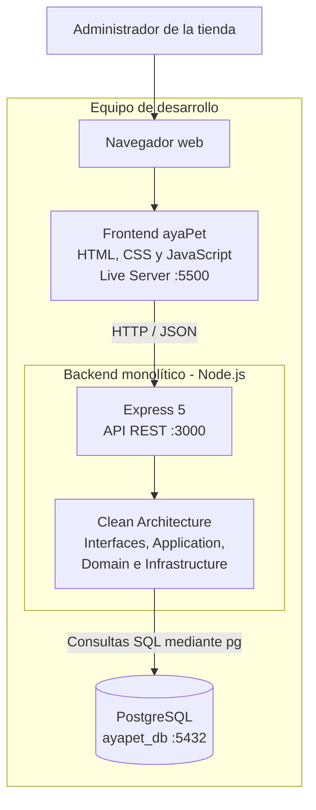

# Diagrama de despliegue

El sistema ayaPet se ejecuta actualmente en un entorno local de desarrollo.

El administrador accede al frontend desde un navegador web. El frontend realiza solicitudes HTTP al backend, que procesa las operaciones y consulta la base de datos PostgreSQL.

## Componentes del despliegue

- **Navegador web:** permite al administrador visualizar el catálogo y gestionar los productos.
- **Frontend:** se ejecuta mediante Live Server y presenta la interfaz de ayaPet.
- **Backend:** aplicación monolítica desarrollada con Node.js y Express 5. Expone los endpoints REST.
- **Base de datos:** PostgreSQL almacena las categorías y los productos.

Este despliegue corresponde al entorno local utilizado para desarrollar y probar el sistema. No representa todavía un despliegue productivo.
