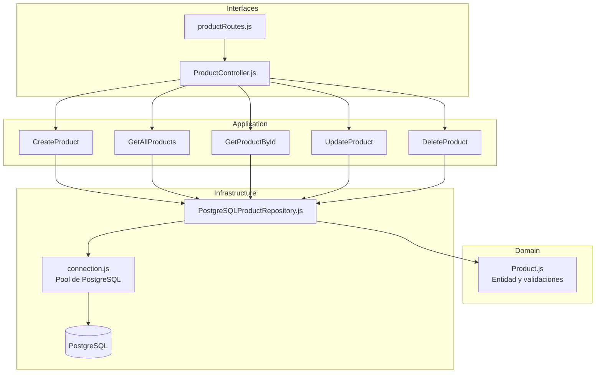

# Diagrama de componentes del backend

El backend de ayaPet está organizado mediante Clean Architecture. Cada capa tiene una responsabilidad y participa en el procesamiento de las operaciones relacionadas con productos.



## Responsabilidad de los componentes

- **Interfaces:** recibe las solicitudes HTTP y entrega las respuestas.
- **Application:** ejecuta los casos de uso del sistema.
- **Domain:** contiene la entidad Product y sus reglas de validación.
- **Infrastructure:** realiza las operaciones de persistencia en PostgreSQL.
```
