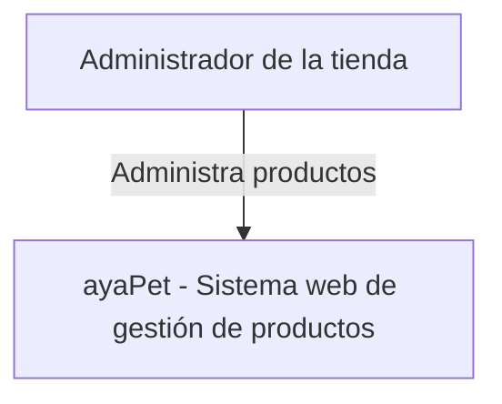

# C4 – Nivel 1: Diagrama de Contexto

## Descripción

ayaPet es un sistema web de gestión de productos para una tienda de mascotas. Su finalidad es permitir al administrador gestionar el catálogo de productos mediante operaciones de registro, consulta, actualización y eliminación.

## Actor principal

**Administrador de la tienda:** usuario responsable de gestionar la información de los productos disponibles en el sistema.

## Alcance del sistema

El sistema permite:
- Registrar productos.
- Consultar el catálogo de productos.
- Actualizar información de productos.
- Eliminar productos.

## Relación principal

El administrador interactúa con ayaPet a través de una interfaz web para realizar las operaciones de gestión del catálogo.

## Consideración

El diagrama de contexto representa el sistema desde una perspectiva externa. Los detalles tecnológicos y componentes internos se desarrollarán en los siguientes niveles del modelo C4.

