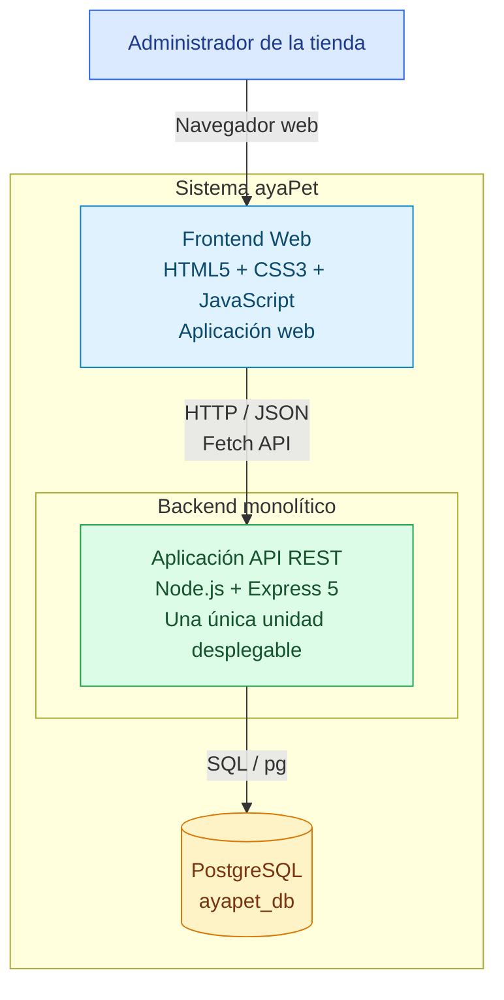

# C4 – Nivel 2: Diagrama de Contenedores

## 1. Descripción general

El sistema ayaPet está compuesto por tres contenedores principales: Frontend Web, Backend API REST y Base de Datos PostgreSQL.

El backend utiliza un estilo arquitectónico monolítico y está organizado internamente siguiendo los principios de Clean Architecture.

## 2. Diagrama de contenedores

## 3. Descripción de los contenedores

### 3.1. Frontend Web

- **Tecnologías:** HTML5, CSS3 y JavaScript Vanilla.
- **Responsabilidad:** presentar la interfaz de usuario y permitir la administración de productos.
- **Comunicación:** consume los servicios del backend mediante Fetch API utilizando HTTP y JSON.

### 3.2. Backend API REST

- **Tecnologías:** Node.js y Express 5.
- **Estilo arquitectónico:** Monolítico.
- **Organización interna:** Clean Architecture.
- **Responsabilidad:** procesar las solicitudes HTTP, ejecutar los casos de uso y coordinar el acceso a los datos.

El backend constituye una única aplicación desplegable que concentra las funcionalidades de gestión de productos.

### 3.3. Base de datos

- **Tecnología:** PostgreSQL.
- **Base de datos:** ayapet_db.
- **Responsabilidad:** almacenar la información de productos y categorías.
- **Comunicación:** recibe consultas SQL desde el backend mediante el paquete pg.

## 4. Relaciones entre contenedores

| Origen | Destino | Tecnología o protocolo | Descripción |
|---|---|---|---|
| Administrador | Frontend | Navegador web | Interactúa con la tienda. |
| Frontend | Backend | HTTP / JSON | Consume la API REST mediante Fetch API. |
| Backend | PostgreSQL | SQL / pg | Consulta y modifica los datos. |

## 5. Decisión arquitectónica

Se seleccionó un estilo arquitectónico monolítico para el backend debido al alcance y la complejidad del proyecto.

La organización interna sigue los principios de Clean Architecture, permitiendo separar las responsabilidades del dominio, aplicación, infraestructura e interfaces.

Esta combinación facilita el mantenimiento, la comprensión y la evolución del sistema sin incorporar la complejidad operativa de los microservicios.