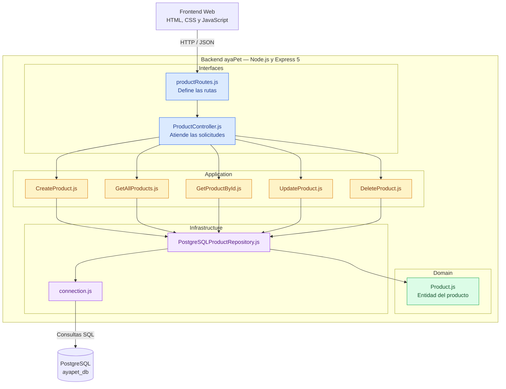

# 03. Diagrama de componentes de ayaPet

## 1. ¿Cómo está organizado el backend?

El backend de ayaPet está desarrollado con Node.js y Express 5. Para organizar el código utilizamos Clean Architecture, separando las responsabilidades en cuatro capas: Interfaces, Application, Domain e Infrastructure.

Cada capa tiene una función dentro del sistema. Esta organización permite identificar dónde se reciben las solicitudes, dónde se ejecutan las operaciones, dónde se encuentran las reglas del producto y cómo se guardan los datos.

## 2. Diagrama de componentes

El siguiente diagrama muestra los principales componentes del backend y cómo se relacionan para realizar las operaciones de gestión de productos.

## 3. ¿Qué hace cada capa?

### Interfaces

Es la parte que recibe las solicitudes del frontend y devuelve las respuestas.

En ayaPet tenemos dos componentes:

- `productRoutes.js`: define las rutas para consultar, registrar, actualizar y eliminar productos.
- `ProductController.js`: recibe los datos de cada solicitud, llama al caso de uso correspondiente y devuelve la respuesta HTTP.

### Application

Aquí se encuentran las operaciones que puede realizar el sistema sobre los productos.

Cada operación tiene su propio archivo:

| Archivo | Función |
|---|---|
| CreateProduct.js | Registra un producto. |
| GetAllProducts.js | Consulta todos los productos. |
| GetProductById.js | Busca un producto por su ID. |
| UpdateProduct.js | Actualiza un producto. |
| DeleteProduct.js | Elimina un producto. |

De esta manera, cada caso de uso se encarga de una operación específica.

### Domain

En esta capa tenemos `Product.js`, que representa al producto dentro del sistema.

Aquí se encuentran las validaciones principales, por ejemplo:

- El nombre no puede estar vacío.
- El precio debe ser mayor que cero.
- El stock debe ser un número entero igual o mayor que cero.
- La categoría debe tener un identificador válido.

Estas reglas se aplican independientemente de cómo se almacenen los productos.

### Infrastructure

Esta capa contiene el código que permite trabajar con PostgreSQL.

Actualmente tenemos:

- `PostgreSQLProductRepository.js`: contiene las consultas SQL para registrar, consultar, actualizar y eliminar productos.
- `connection.js`: configura la conexión con PostgreSQL utilizando el paquete `pg`.

## 4. Ejemplo: ¿qué sucede cuando registramos un producto?

Cuando el administrador completa el formulario y pulsa «Guardar producto», ocurre lo siguiente:

1. El frontend envía los datos mediante una solicitud POST.
2. `productRoutes.js` recibe la solicitud.
3. `ProductController.js` recoge los datos y llama a `CreateProduct`.
4. `CreateProduct.js` ejecuta la operación de registro utilizando el repositorio.
5. `PostgreSQLProductRepository.js` crea y valida la entidad `Product`, y prepara la consulta SQL.
6. `connection.js` proporciona la conexión con PostgreSQL.
7. PostgreSQL guarda el nuevo producto.
8. El backend devuelve el resultado al frontend.

## 5. ¿Por qué organizamos el backend de esta manera?

Decidimos utilizar Clean Architecture para que el código no esté concentrado en un solo archivo.

Por ejemplo, si necesitamos modificar la forma en que se registran los productos, podemos trabajar en el caso de uso correspondiente sin tener que mezclar esa lógica con las rutas o la conexión a la base de datos.

Además, esta organización facilita encontrar errores y realizar cambios cuando el sistema necesite nuevas funcionalidades.

## 6. Relación con la arquitectura del proyecto

ayaPet utiliza un backend monolítico: todos los componentes del backend forman parte de una misma aplicación.

Dentro de esa aplicación, Clean Architecture nos permite organizar el código y separar las responsabilidades.

En la implementación actual, los casos de uso reciben el repositorio PostgreSQL mediante inyección de dependencias. Todavía no hemos creado una interfaz independiente para ese repositorio.

Por tanto, el diagrama representa la organización que tenemos actualmente en el código.
