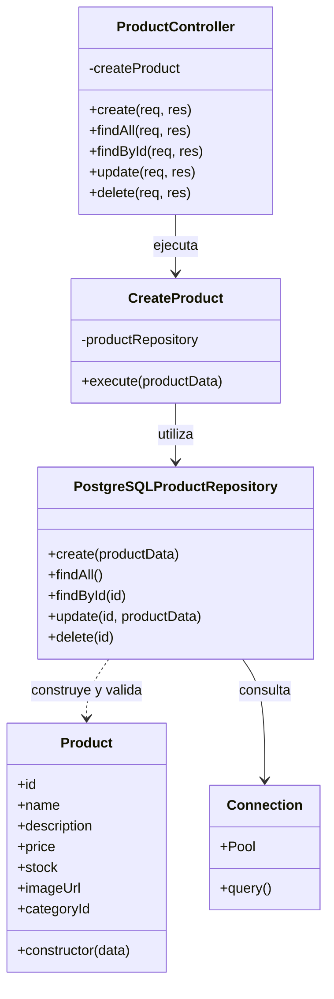

# 04. Diagrama de código de ayaPet

## 1. Descripción

En este nivel mostramos cómo están relacionadas algunas de las clases principales del backend de ayaPet.

Para entenderlo mejor, tomaremos como ejemplo el registro de un producto, desde que llega la solicitud HTTP hasta que se almacena en PostgreSQL.

No es necesario representar todos los archivos del proyecto. Nos centraremos en los componentes que participan directamente en esta operación.

## 2. Diagrama de clases



## 3. ¿Qué representa cada clase?

### ProductController

Es el controlador que recibe las solicitudes HTTP relacionadas con los productos.

Por ejemplo, cuando el administrador registra un producto, este controlador recibe los datos y llama al caso de uso `CreateProduct`.

### CreateProduct

Es el caso de uso encargado del registro de productos.

Recibe los datos y utiliza el repositorio para ejecutar la operación correspondiente.

### Product

Es la entidad que representa un producto de ayaPet.

Contiene sus atributos y las validaciones que deben cumplirse, como el nombre obligatorio, el precio positivo y el stock válido.

### PostgreSQLProductRepository

Es el repositorio que implementa las operaciones sobre la tabla `products`.

Contiene los métodos para registrar, consultar, actualizar y eliminar productos.

También utiliza la entidad `Product` para validar los datos antes de realizar determinadas operaciones de persistencia.

### Connection

Es el módulo encargado de proporcionar la conexión con PostgreSQL mediante el paquete `pg`.

Permite que el repositorio ejecute las consultas SQL.

## 4. Ejemplo de funcionamiento: registrar un producto

Cuando el administrador registra un producto desde la interfaz web, los componentes trabajan de la siguiente manera:

1. `ProductController` recibe los datos enviados por el frontend.
2. Ejecuta el caso de uso `CreateProduct`.
3. `CreateProduct` llama al método `create()` del repositorio.
4. El repositorio construye una instancia de `Product` y ejecuta las validaciones de la entidad.
5. Si los datos son válidos, el repositorio prepara la consulta SQL.
6. `Connection` permite ejecutar la consulta en PostgreSQL.
7. El resultado retorna al controlador y se envía una respuesta al frontend.

## 5. Relación con la estructura del proyecto

Las clases y archivos representados se encuentran organizados de la siguiente manera:

```text
backend/
└── src/
    ├── domain/
    │   └── entities/
    │       └── Product.js
    │
    ├── application/
    │   └── use-cases/
    │       └── CreateProduct.js
    │
    ├── infrastructure/
    │   ├── database/
    │   │   └── connection.js
    │   │
    │   └── repositories/
    │       └── PostgreSQLProductRepository.js
    │
    └── interfaces/
        └── http/
            └── controllers/
                └── ProductController.js
```

## 6. ¿Por qué es importante este nivel?

Este diagrama permite comprender cómo se relacionan las clases que participan en una operación del sistema.

También facilita ubicar cada responsabilidad dentro del código y entender cómo se conectan el controlador, el caso de uso, la entidad y el repositorio.

De esta manera, la documentación no se queda solamente en explicar cómo está organizada la arquitectura, sino que permite relacionarla con la implementación real de ayaPet.
